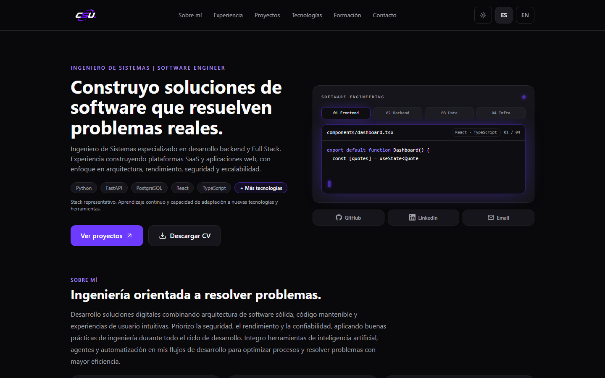
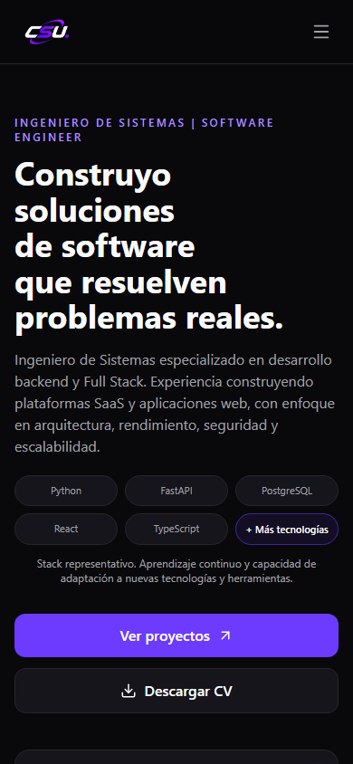

# CSU · Portfolio

Personal portfolio of **Carlos Santiago Urrego Jiménez** — Software Engineer focused on Backend, Full Stack Development and Software Architecture.

**Live demo:** https://carlos-urrego-portfolio.onrender.com/es/

## Preview

| Desktop | Mobile |
| --- | --- |
|  |  |

## Overview

Bilingual (ES/EN) static portfolio with dark/light themes, animated live-code hero, project case studies and technology ecosystem. Content is centralized and typed; images go through a single registry (`src/shared/presentation/assets/images.ts`).

- 6 sections: About, Experience, Projects, Stack, Education, Contact
- ES/EN static routes (`/es`, `/en`), no runtime i18n library
- Dual theme with CSS variables and persisted mode
- Scroll-reveal system built on Framer Motion (single-run, `prefers-reduced-motion` aware)
- Official brand glyphs (Simple Icons, vendored locally) + Lucide for concepts

## Technology Stack

| Layer | Tools |
| --- | --- |
| Framework | Next.js (static export), React, TypeScript |
| Styling | Tailwind CSS, CSS variables |
| Motion | Framer Motion (no GSAP/Lenis) |
| Icons | Lucide + vendored Simple Icons paths |
| Testing | Vitest (unit) + Playwright (e2e Chromium/Firefox/WebKit, a11y, visual) |
| Deploy | Render Static Site (`npm ci && npm run build`, publish `out/`) |

## Architecture

Decisions are recorded as ADRs in [`docs/`](docs/):

- [ADR-001](docs/adr-001.md) — hybrid modular monolith
- [ADR-002](docs/adr-002.md), [ADR-003](docs/adr-003.md), [ADR-004](docs/adr-004.md), [ADR-005](docs/adr-005.md)

Key rules: single source of truth for images and content, no hardcoded `/images/*` paths outside the registry, ES/EN translations centralized, no invented metrics.

## Getting Started

Requirements: Node.js 20+.

```bash
npm ci
npm run dev        # local development
npm run build      # static export to out/
npx serve out -l 4173
```

Open http://127.0.0.1:4173/es/ (or `/en/`).

## Testing & Quality

```bash
npm run typecheck  # tsc --noEmit, 0 errors
npm run lint       # eslint, 0 errors
npm run test:unit  # vitest
npm run build      # Next.js static export, 15 routes
npx playwright test                                  # e2e: Chromium, Firefox, WebKit
npx playwright test --config playwright.visual.config.ts  # visual regression
```

Quality gate before any push to `main`: typecheck, lint, unit, build, full Playwright suite and reviewed screenshots across 320–1920 px, dark/light and ES/EN.

## Deployment

Render Static Site tracking `main`: build command `npm ci && npm run build`, publish directory `out/`. Every merge to `main` redeploys automatically after the quality gate passes.
